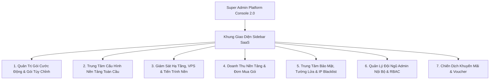

# KẾ HOẠCH NÂNG CẤP & TÁI CẤU TRÚC TOÀN DIỆN SUPER ADMIN (PLATFORM CONSOLE 2.0)

> **Tài liệu chiến lược & Lộ trình kỹ thuật**  
> **Dự án**: Digistay Platform Management Console  
> **Ngày cập nhật**: 10/11/2026  
> **Định hướng cốt lõi**: Định vị lại Super Admin thành **Bảng điều khiển Quản trị Nền tảng (Platform Operator Console)** đích thực. Tập trung 100% vào:
> 1. **Giao diện hiện đại (Modern SaaS UI/UX)**: Sidebar cố định chuẩn Stripe/Vercel, Dark/Light theme, thanh tìm kiếm toàn cầu.
> 2. **Động hóa toàn diện Gói cước (Dynamic & Custom Plans Engine)**: Xóa bỏ 3 gói cứng cũ, cho phép Super Admin tự tạo gói mới, tạo gói tùy chỉnh (Custom / VIP Plan) và cấu hình công tắc tính năng linh hoạt.
> 3. **Cấu hình Nền tảng Toàn cầu (Global Platform Settings)**: Quản lý biến môi trường, API keys (PayOS, Mắt Bão, Gemini AI, Cloudinary, SMTP) trực tiếp trên Web UI không cần SSH vào VPS.
> 4. **Giám sát Hạ tầng, Máy chủ & Tài nguyên (Infrastructure & Health)**: Đo lường CPU/RAM/Disk VPS, Postgres, Redis, Trigger Cronjob 1-click.
> 5. **Bảo mật, Phân quyền Admin Nội bộ & Tường lửa (Security, RBAC & IP Blacklist)**.

---

## I. NHỮNG ĐIỂM BẤT TIỆN LỚN CỦA PHÂN HỆ HIỆN TẠI

### 1. Sự bất tiện trong Quản lý Gói cước (Plans Engine)
* **Bị trói cứng vào 3 gói tĩnh**: Mã nguồn hiện tại ép buộc chỉ có 3 định danh gói `starter`, `growth`, `business`. Super Admin chỉ có thể chỉnh sửa giá tiền hoặc giới hạn phòng của 3 gói này mà **không thể tự tạo thêm bất kỳ gói mới nào**.
* **Không thể tạo Gói Tùy Chỉnh (Custom / Enterprise Plan)**:
  - Khi có một đối tác lớn, chuỗi khách sạn hoặc khách VIP muốn đàm phán một gói riêng (ví dụ: *"Gói Đối Tác 2026: 50 cơ sở, 500 phòng, tặng kèm 1000 lượt AI"* với giá thỏa thuận riêng), Super Admin hoàn toàn **bó tay**, không có cách nào tạo gói đó trên hệ thống.
* **Không có công tắc tính năng (Feature Flags)**: Không thể chủ động bật/tắt quyền dùng Tên miền riêng, Chatbot AI, Đồng bộ iCal OTA... cho từng gói cước.

### 2. Sự bất tiện về Cấu hình Hệ thống (Configuration Management)
* Muốn đổi API Key PayOS, đổi mật khẩu Mắt Bão, cập nhật Gemini API Key hay cấu hình Email SMTP thì Super Admin đều phải:
  - Mở terminal SSH vào VPS (`/opt/digistay/.env`).
  - Dùng lệnh nano/vim sửa file thủ công, rồi chạy lại docker.
  - Quá rủi ro, dễ gõ sai định dạng làm crash toàn bộ app, và người không rành dòng lệnh không thể thao tác được.

### 3. Giao diện cũ kỹ, thiếu chuyên nghiệp (UI/UX)
* Thanh tab ngang trượt ngang (`admin-frame.tsx`) bị tràn màn hình, khó quan sát.
* Trang hệ thống (`/admin/system`) hiển thị text thô sơ dạng log không có đồ họa trực quan.
* Thiếu bảng điều khiển kiểm soát tài nguyên máy chủ (dung lượng ổ cứng VPS, RAM, CPU).

---

## II. MA TRẬN SO SÁNH: TÍNH NĂNG HIỆN CÓ VS SUPER ADMIN 2.0

| Phân hệ chức năng | Hiện trạng (v1.0) | Đề xuất Super Admin 2.0 (Platform Console) |
| :--- | :--- | :--- |
| **Giao diện & Bố cục** | Header ngang trượt tab hẹp, dễ tràn viền. | **Sidebar cố định chuẩn SaaS Enterprise**: Collapsible, icon Lucide sắc nét, tối ưu diện tích làm việc, Dark/Light mode chuẩn token Digistay. |
| **Quản lý Gói cước** | Cố định 3 gói (`starter`, `growth`, `business`). Không tạo được gói mới. | **Engine Gói Động & Gói Tùy Chỉnh (Dynamic & Custom Plans)**: Tạo không giới hạn gói mới, tạo gói VIP/Private cho khách hàng đàm phán riêng, công tắc tính năng linh hoạt. |
| **Cấu hình Nền tảng** | Sửa thủ công trong file `.env` qua SSH terminal. | **Trung tâm Cấu hình Nền tảng (`/admin/platform-settings`)**: Quản lý PayOS, Mắt Bão, Gemini AI, Cloudinary, SMTP, Hotline trực tiếp trên giao diện với AES-256 mã hóa an toàn. |
| **Giám sát Hạ tầng VPS** | Chỉ kiểm tra ping version cơ bản. | **Infrastructure Monitor (`/admin/infrastructure`)**: Đo lường CPU, RAM, Disk Usage ổ đĩa VPS (chống đầy ổ cứng), dung lượng Postgres DB, Redis latency. |
| **Điều khiển Cronjob** | Chỉ hiển thị lịch sử chạy dạng text. | **Cronjob & Worker Control Center**: Hiển thị trạng thái các tiến trình nền, kèm nút **"Kích hoạt chạy bù ngay (Trigger Now)"** 1-click khi có sự cố. |
| **Bảo mật & Tường lửa** | Chỉ có rate limit ngầm trong code. | **Security & Firewall Center (`/admin/security`)**: Danh sách IP Blacklist (chặn spammer/bot), chặn từ khóa subdomain nhạy cảm, cảnh báo brute-force. |
| **Phân quyền Admin Nội bộ** | Chỉ có 1 role `SUPER_ADMIN`. | **RBAC Admin Nội bộ (`/admin/team`)**: Quản lý tài khoản ban quản trị, phân quyền theo chức năng (`Super Admin`, `Kế toán/Billing`, `Hạ tầng/DevOps`). |
| **Voucher & Khuyến mãi** | Đã có CRUD cơ bản ở Task 50. | **Campaign & Voucher Engine**: Thống kê số tiền chiết khấu đã tài trợ, giới hạn số lần dùng toàn sàn, tỷ lệ áp dụng thành công. |

---

## III. THIẾT KẾ CHI TIẾT CÁC PHÂN HỆ ĐỘT PHÁ CỦA SUPER ADMIN 2.0



---

### PHÂN HỆ 1: ENGINE QUẢN LÝ GÓI ĐỘNG & GÓI TÙY CHỈNH (CUSTOM PLANS)

#### 1. Cấu trúc dữ liệu linh hoạt (`SubscriptionPlan`)
Hệ thống lưu trữ toàn bộ gói cước vào cơ sở dữ liệu thay vì hằng số code:

```prisma
model SubscriptionPlan {
  id              String      @id @default(cuid())
  code            String      @unique // e.g. "starter", "growth", "business", "vip-homestay", "custom-phuquoc"
  name            String      // "Gói Starter", "Gói Tăng Trưởng", "Gói Đối Tác VIP"
  description     String?     @db.Text
  
  // Định giá
  priceMonthly    Float       // Giá tháng (VNĐ)
  priceYearly     Float       // Giá năm (VNĐ)
  
  // Hạn mức tài nguyên hệ thống (Quotas)
  maxProperties   Int         @default(1)    // Số cơ sở tối đa được tạo
  maxRooms        Int         @default(15)   // Số phòng tối đa quản lý
  maxStaff        Int         @default(3)    // Số tài khoản nhân viên
  monthlyAiQuota  Int         @default(30)   // Lượt tạo bài viết / dùng AI mỗi tháng
  
  // Công tắc tính năng linh hoạt (Feature Flags)
  hasCustomDomain Boolean     @default(false)// Cho phép dùng tên miền riêng (.vn, .com)
  hasChatbotAi    Boolean     @default(true) // Cho phép bật Trợ lý ảo AI trên website
  hasOtaIcalSync  Boolean     @default(true) // Cho phép đồng bộ lịch 2 chiều với Airbnb/Booking
  hasAdvancedReports Boolean  @default(true) // Báo cáo tài chính chuyên sâu & sổ quỹ
  
  // Phân loại & Quyền riêng tư
  isPublic        Boolean     @default(true) // true: Hiện công khai trên bảng giá / false: Gói riêng (Private/Custom)
  isActive        Boolean     @default(true) // true: Đang mở đăng ký / false: Đã dừng bán
  isFeatured      Boolean     @default(false)// Gắn nhãn "Nổi bật / Khuyên dùng"
  displayOrder    Int         @default(0)    // Thứ tự hiển thị
  
  createdAt       DateTime    @default(now())
  updatedAt       DateTime    @updatedAt

  @@map("subscription_plans")
}
```

#### 2. Tính năng nổi bật trên Giao diện Quản lý Gói:
* **Tạo Gói Cước Mới Tùy Ý (Create New Plan)**:
  - Điền tên gói, giá theo tháng, giá theo năm.
  - Kéo thanh trượt hoặc nhập số lượng: Số cơ sở, Số phòng, Số nhân viên, Lượt AI.
  - Bật/tắt các công tắc tính năng (Tên miền riêng, Chatbot AI, Đồng bộ OTA).
  - Chọn `Công khai`: Gói sẽ tự động hiển thị trên Landing Page Bảng giá (`/pricing`) và trang Checkout mà không cần sửa code.
* **Tạo Gói Tùy Chỉnh Riêng Biệt (Custom / Private Plan)**:
  - Bật tùy chọn `Gói riêng (Private Plan)`: Gói sẽ **không hiển thị** trên bảng giá chung.
  - Cung cấp tính năng **Gán gói cước trực tiếp cho một khách hàng / workspace bất kỳ**: Super Admin chỉ cần chọn Workspace của khách hàng và chọn Gói tùy chỉnh này để kích hoạt.
  - Sinh link đăng ký riêng (`https://digistay.vn/pricing/checkout?plan=custom-phuquoc&token=xxx`) gửi cho đối tác lớn thanh toán đúng mức giá đã đàm phán.

---

### PHÂN HỆ 2: TRUNG TÂM CẤU HÌNH NỀN TẢNG TOÀN CẦU (`/admin/platform-settings`)

Loại bỏ việc phải SSH vào VPS để chỉnh sửa cấu hình. Toàn bộ cấu hình quan trọng được quản lý tập trung và bảo mật:

1. **Cấu hình Cổng thanh toán PayOS Nền tảng** (Thu tiền bán gói phần mềm):
   - `PayOS Client ID`, `API Key`, `Checksum Key`.
   - Trạng thái kiểm tra kết nối PayOS tự động (Ping Test 1-click).
   - Hiển thị URL Webhook tiếp nhận thanh toán gói.
2. **Cấu hình Xuất hóa đơn GTGT Mắt Bão Nền tảng** (Xuất hóa đơn điện tử khi khách mua gói):
   - Môi trường (Demo / Thật), MST công ty Digistay, Tài khoản, Mật khẩu (mã hóa AES-256).
   - Ký hiệu hóa đơn (Series), Mẫu số hóa đơn.
3. **Cấu hình Google Gemini AI Nền tảng**:
   - `GEMINI_API_KEY` của hệ thống.
   - Chọn Model mặc định (`gemini-2.5-flash`, `gemini-1.5-flash`).
   - Nút kiểm tra trạng thái hoạt động của Gemini API.
4. **Cấu hình Dịch vụ Lưu trữ & Email SMTP**:
   - Cloudinary: Cloud Name, API Key, API Secret.
   - SMTP Server: Host, Port, Username, Password, Sender Name, Sender Email.
   - Nút "Gửi email thử nghiệm" để kiểm tra đường truyền gửi thư.
5. **Thông tin Nền tảng & Pháp lý**:
   - Hotline hỗ trợ Digistay, Email hỗ trợ, Địa chỉ công ty, Tên công ty pháp lý.

---

### PHÂN HỆ 3: GIÁM SÁT HẠ TẦNG, VPS & TIẾN TRÌNH NỀN (`/admin/infrastructure`)

Chuyển đổi trang kỹ thuật cũ thành Bảng điều khiển Sức khỏe Hạ tầng cao cấp:

1. **Giám sát Máy chủ VPS (Server Metrics)**:
   - **Dung lượng Ổ đĩa (Disk Usage)**: % dung lượng ổ cứng đã dùng trên VPS, cảnh báo đỏ khi ổ cứng vượt 80% (ngăn chặn sự cố Docker bị đứng do đầy log).
   - **Tài nguyên RAM & CPU**: Mức độ sử dụng bộ nhớ và tải CPU tức thời.
   - **Thời gian Uptime**: Số ngày/giờ hệ thống đã vận hành liên tục không gián đoạn.
2. **Giám sát Cơ sở dữ liệu & Bộ nhớ đệm**:
   - **PostgreSQL**: Kích thước database, số lượng kết nối đang mở (active pool connections), thời gian bản backup gần nhất.
   - **Redis Cache**: Trạng thái kết nối, độ trễ ping (ms), tỷ lệ cache hit rate, số lượng key đang lưu trữ.
3. **Trung tâm Điều khiển Tiến trình Tự động (Cronjobs & Background Workers)**:
   - Danh sách các job định kỳ:
     - Nhắc giỏ hàng bỏ quên (`abandoned-cart`)
     - Cảnh báo và xử lý gói hết hạn / ân hạn (`subscription-status`)
     - Quét và giải phóng phòng khóa tạm quá hạn (`expired-locks`)
     - Dọn dẹp dữ liệu đã xóa quá 30 ngày (`purge-deleted`)
   - Nút **"Kích hoạt chạy ngay (Trigger Now)"** cho từng job để Super Admin có thể xử lý tức thì khi cần bảo trì.

---

### PHÂN HỆ 4: TRUNG TÂM BẢO MẬT, TƯỜNG LỬA & IP BLACKLIST (`/admin/security`)

Các công cụ chuyên dụng để Super Admin bảo vệ nền tảng khỏi tấn công và lạm dụng:

1. **Danh sách Chặn IP (IP Blacklist & Firewall)**:
   - Danh sách các IP bị cấm truy cập hệ thống kèm lý do (spam đặt phòng ảo, cố tình quét lỗ hổng, spam OTP đăng ký).
   - Nút "Thêm IP vào danh sách chặn" và "Bỏ chặn".
2. **Quản lý Subdomain Nhạy cảm (Reserved Subdomains Blacklist)**:
   - Danh sách các tên miền con bị cấm đăng ký để tránh giả mạo (ví dụ: `admin`, `api`, `payos`, `bank`, `support`, `root`, `auth`, `digistay`...).
   - Cho phép Super Admin bổ sung các từ khóa cấm mới.
3. **Cảnh báo Bảo mật Thời gian Thực**:
   - Thống kê các lượt thử mật khẩu sai liên tiếp, các yêu cầu vượt ngưỡng Rate Limit bị hệ thống chặn đứng.

---

### PHÂN HỆ 5: QUẢN LÝ ĐỘI NGŨ ADMIN NỘI BỘ & PHÂN QUYỀN RBAC (`/admin/team`)

1. **Danh sách Nhân sự Quản trị Digistay**:
   - Hiển thị danh sách các tài khoản có quyền truy cập vào cổng Super Admin.
   - Tình trạng kích hoạt xác thực 2 lớp (2FA).
2. **Phân quyền Vai trò Quản trị (Admin Roles)**:
   - `SUPER_ADMIN`: Toàn quyền tối cao (Cấu hình hệ thống, sửa gói, quản lý team).
   - `BILLING_ADMIN`: Chỉ quản lý đơn hàng mua gói, hóa đơn Mắt Bão và voucher khuyến mãi.
   - `OPS_ADMIN`: Giám sát sức khỏe hạ tầng, kiểm tra log, kích hoạt cronjob.
3. **Thao tác nhanh**: Thêm nhân viên quản trị mới, cấp/thu hồi quyền, reset 2FA cho nhân sự nội bộ.

---

## IV. THIẾT KẾ GIAO DIỆN MỚI (SUPER ADMIN 2.0 UI/UX DESIGN SYSTEM)

### 1. Bố cục Khung làm việc (Sidebar Layout Hiện Đại)
* **Sidebar cố định bên trái (Fixed Navigation)**:
  - Độ rộng chuẩn 260px (hỗ trợ thu gọn về 72px với icon tooltip).
  - Logo Digistay phối màu sang trọng kèm nhãn phát sáng tím `PLATFORM OPERATOR`.
  - Phân nhóm điều hướng mạch lạc:
    - **TỔNG QUAN NỀN TẢNG**:
      - 📊 `Dashboard Tổng quan` (`/admin`)
      - 📈 `Doanh thu & Đơn mua gói` (`/admin/orders`)
    - **KINH DOANH & GÓI CƯỚC**:
      - 💳 `Quản lý Gói & Gói Tùy Chỉnh` (`/admin/plans`)
      - 🎟️ `Chiến dịch Voucher` (`/admin/vouchers`)
    - **HẠ TẦNG & HỆ THỐNG**:
      - 🖥️ `Sức khỏe Hạ tầng & Server` (`/admin/infrastructure`)
      - ⚙️ `Cấu hình Nền tảng Toàn cầu` (`/admin/platform-settings`)
    - **BẢO MẬT & VẬN HÀNH**:
      - 🛡️ `Bảo mật & Tường lửa IP` (`/admin/security`)
      - 👥 `Đội ngũ Admin Nội bộ` (`/admin/team`)
      - 📜 `Nhật ký Kiểm toán Toàn sàn` (`/admin/activity`)
* **Thanh Header trên cùng (Smart Operator Topbar)**:
  - Thanh tìm kiếm thông minh `Universal Search` với phím tắt `Ctrl + K`.
  - Đèn báo tín hiệu sức khỏe dịch vụ: `Postgres: OK` 🟢 | `Redis: OK` 🟢 | `PayOS: OK` 🟢.
  - Nút chuyển nhanh Dark/Light theme và nút "Thoát về Workspace".

---

## V. LỘ TRÌNH TRIỂN KHAI CHI TIẾT (4 SPRINT)

```mermaid
flowchart TD
    subgraph Sprint 1: Khung Sidebar Layout & Design System Mới
        S1_1[Xây dựng AdminSidebarLayout chuẩn SaaS]
        S1_2[Universal Search Bar Ctrl+K]
        S1_3[Chuyển đổi theme & responsive hoàn hảo]
    end

    subgraph Sprint 2: Engine Gói Động & Gói Tùy Chỉnh
        S2_1[Tạo model SubscriptionPlan & Migration DB]
        S2_2[API CRUD gói cước động & Feature Flags]
        S2_3[Giao diện /admin/plans mới: Thẻ gói & Modal tạo gói Custom]
        S2_4[Chức năng gán gói Custom cho Workspace]
    end

    subgraph Sprint 3: Trung Tâm Cấu Hình Nền Tảng & Hạ Tầng
        S3_1[Trang Cấu hình Nền tảng /admin/platform-settings: PayOS, Mắt Bão, AI, SMTP]
        S3_2[Trang Giám sát Hạ tầng /admin/infrastructure: CPU/RAM/Disk, Postgres, Redis]
        S3_3[Trigger thủ công các tiến trình Cronjob]
    end

    subgraph Sprint 4: Bảo Mật, Đội Ngũ Admin & Kiểm Toán
        S4_1[Trang Bảo mật & IP Blacklist /admin/security]
        S4_2[Trang Đội ngũ Admin Nội bộ & Phân quyền /admin/team]
        S4_3[Kiểm thử toàn diện, verify 100% test suite & build production]
    end

    Sprint 1 --> Sprint 2
    Sprint 2 --> Sprint 3
    Sprint 3 --> Sprint 4
```

---

## VI. TIÊU CHÍ NGHIỆM THU (SUCCESS CRITERIA)

1. **Trải nghiệm giao diện đột phá**: Bố cục Sidebar sang trọng, hiện đại, xóa bỏ hoàn toàn thanh tab ngang cũ, thao tác mượt mà và trực quan.
2. **Tự do tuyệt đối về gói cước**:
   - Super Admin tạo gói cước mới hoặc gói tùy chỉnh (Custom Plan) trong vòng 30 giây ngay trên giao diện web.
   - Tự do cấu hình giá, hạn mức cơ sở/phòng/nhân viên/AI và bật/tắt các công tắc tính năng.
   - Gán gói tùy chỉnh cho bất kỳ khách hàng nào chỉ với 1 click.
3. **Vận hành không chạm dòng lệnh**:
   - Toàn bộ cấu hình API PayOS, Mắt Bão, Gemini AI, SMTP được quản lý trực tiếp trên giao diện, không cần SSH vào VPS.
4. **An toàn tuyệt đối**:
   - Đảm bảo 100% test suite tiếp tục vượt qua (`0 failed`), bảo toàn tương thích dữ liệu hiện có.
