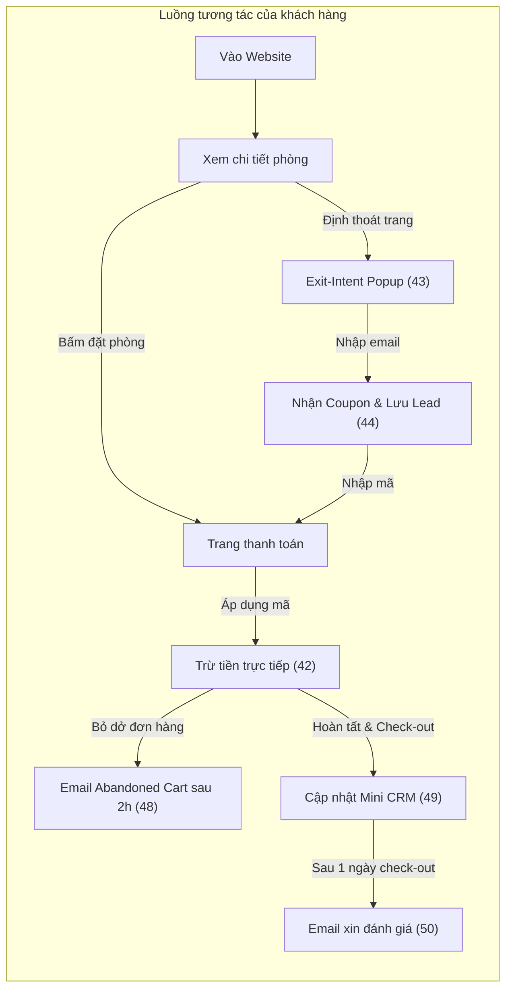
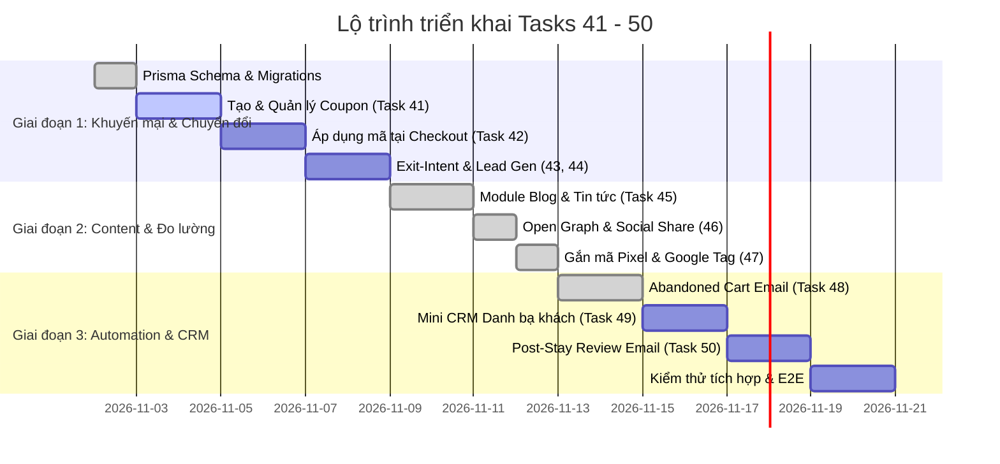

# Kế hoạch triển khai: Marketing, Tăng trưởng Chuyển đổi & Mini CRM (Task 41 - 50)

Tài liệu kế hoạch kỹ thuật chi tiết nhằm triển khai 10 tính năng mở rộng thuộc phân hệ Tiếp thị, Tối ưu chuyển đổi (CRO), Chăm sóc khách hàng tự động và Mini CRM cho hệ thống quản lý khách sạn đa cơ sở **Digistay**.

---

## 1. Danh sách tính năng & Yêu cầu

| ID | Tên tính năng | Mô tả yêu cầu nghiệp vụ |
| :--- | :--- | :--- |
| **41** | **Tạo và quản lý Mã giảm giá (Voucher / Coupon)** | Chủ cơ sở tạo được các mã giảm giá: giảm theo % hoặc số tiền cố định, giới hạn số lần sử dụng, cài đặt ngày bắt đầu và kết thúc, đơn tối thiểu. |
| **42** | **Áp dụng mã giảm giá tại trang thanh toán** | Khách đặt phòng nhập mã giảm giá → Hệ thống kiểm tra điều kiện hợp lệ và trừ tiền trực tiếp trên tổng đơn ngay lập tức. |
| **43** | **Cửa sổ bật giữ chân khách (Exit-Intent Popup)** | Khi khách có thao tác chuẩn bị tắt trang hoặc chuyển tab, popup hiện lên: *"Đừng bỏ lỡ! Nhập email để nhận mã giảm 10% ngay hôm nay"*. |
| **44** | **Thu thập dữ liệu khách hàng tiềm năng (Lead Generation)** | Toàn bộ thông tin khách để lại qua popup hoặc biểu mẫu liên hệ được lưu vào danh sách khách hàng tiềm năng trong bảng quản trị. |
| **45** | **Module Viết bài Blog & Tin tức quảng bá** | Trình soạn thảo bài viết đơn giản giúp khách sạn đăng tải các bài giới thiệu món ăn ngon, cẩm nang tham quan du lịch xung quanh cơ sở. |
| **46** | **Tối ưu hiển thị mạng xã hội & Chia sẻ liên kết** | Tự động gắn ảnh đại diện, tiêu đề hấp dẫn khi chủ cơ sở copy link website gửi qua Zalo, Facebook hoặc Messenger (Open Graph / SEO Meta). |
| **47** | **Gắn mã đo lường tiếp thị (Facebook Pixel, Google Tag)** | Ô nhập mã đo lường đơn giản giúp chủ khách sạn gắn mã theo dõi quảng cáo Facebook/Google mà không cần biết can thiệp mã nguồn. |
| **48** | **Gửi Email nhắc nhở phòng chưa hoàn tất (Abandoned Cart)** | Nếu khách đã chọn phòng, điền thông tin nhưng chưa thanh toán → 2 tiếng sau hệ thống tự gửi email nhắc nhở kèm link thanh toán lại. |
| **49** | **Quản lý danh bạ khách hàng cũ (Mini CRM)** | Lưu lịch sử tất cả các khách đã từng ở: Số lần đặt phòng, tổng số tiền đã chi, sở thích cá nhân để phục vụ cho các đợt tiếp thị sau này. |
| **50** | **Gửi Email chăm sóc sau chuyến đi & Xin đánh giá** | 1 ngày sau khi khách check-out, hệ thống tự động gửi email cảm ơn và mời khách chấm điểm dịch vụ, viết nhận xét hiển thị lên website. |

---

## 2. Kiến trúc & Thiết kế Cơ sở dữ liệu (Prisma Schema)

Hệ thống Digistay áp dụng kiến trúc multi-tenant (`Workspace` -> `Property`), soft delete (`deletedAt`), và kiểm soát phân quyền nghiêm ngặt theo Permission.

### 2.1. Thay đổi trong `prisma/schema.prisma`

```prisma
// ============================================================================
// 1. MÃ GIẢM GIÁ (VOUCHER / COUPON) - Task 41, 42
// ============================================================================
enum DiscountType {
  PERCENT      // Giảm theo % (vd: 10%, 15%)
  FIXED_AMOUNT // Giảm số tiền cố định (vd: 100,000 VND)
}

model Coupon {
  id              String       @id @default(cuid())
  propertyId      String
  property        Property     @relation(fields: [propertyId], references: [id], onDelete: Cascade)

  code            String       // Mã viết hoa, không dấu, vd: HELLO2026
  name            String       // Tên chương trình hiển thị nội bộ
  discountType    DiscountType @default(PERCENT)
  discountValue   Float        // Giá trị % hoặc VNĐ
  maxDiscount     Float?       // Mức giảm tối đa (khi discountType = PERCENT)
  minOrderAmount  Float?       // Giá trị đơn phòng tối thiểu để được áp dụng
  startDate       DateTime     // Thời điểm bắt đầu
  endDate         DateTime     // Thời điểm kết thúc
  usageLimit      Int?         // Giới hạn tổng số lần sử dụng (null = vô hạn)
  usageCount      Int          @default(0) // Số lần đã áp dụng thành công
  isActive        Boolean      @default(true)

  bookings        Booking[]

  createdAt       DateTime     @default(now())
  updatedAt       DateTime     @updatedAt
  deletedAt       DateTime?    // Xoá mềm (soft-delete)

  @@unique([propertyId, code])
  @@index([propertyId, isActive, startDate, endDate])
  @@map("coupons")
}

// ============================================================================
// 2. KHÁCH HÀNG TIỀM NĂNG (LEAD GENERATION) - Task 43, 44
// ============================================================================
model Lead {
  id          String    @id @default(cuid())
  propertyId  String
  property    Property  @relation(fields: [propertyId], references: [id], onDelete: Cascade)

  email       String
  phone       String?
  name        String?
  source      String    @default("EXIT_POPUP") // EXIT_POPUP, CONTACT_FORM, BLOG_CTA
  notes       String?
  metadata    Json?     // Lưu trang đang xem, mã coupon đã tặng, v.v.

  createdAt   DateTime  @default(now())
  updatedAt   DateTime  @updatedAt

  @@index([propertyId, email])
  @@map("leads")
}

// ============================================================================
// 3. BLOG & TIN TỨC QUẢNG BÁ - Task 45, 46
// ============================================================================
model BlogPost {
  id              String    @id @default(cuid())
  propertyId      String
  property        Property  @relation(fields: [propertyId], references: [id], onDelete: Cascade)

  title           String
  slug            String    // URL thân thiện (vd: top-5-quan-an-ngon-gan-khach-san)
  summary         String?   // Tóm tắt cho SEO & thẻ mạng xã hội
  content         String    // Nội dung bài viết (Markdown hoặc Rich HTML)
  coverImage      String?   // Ảnh đại diện bài viết
  isPublished     Boolean   @default(false)
  publishedAt     DateTime?
  authorName      String?   // Tên tác giả hiển thị
  
  // SEO tuỳ chỉnh riêng cho bài viết
  metaTitle       String?
  metaDescription String?

  createdAt       DateTime  @default(now())
  updatedAt       DateTime  @updatedAt
  deletedAt       DateTime?

  @@unique([propertyId, slug])
  @@index([propertyId, isPublished, publishedAt])
  @@map("blog_posts")
}

// ============================================================================
// 4. MINI CRM: HỒ SƠ & SỞ THÍCH KHÁCH HÀNG - Task 49
// ============================================================================
model CustomerProfile {
  id          String    @id @default(cuid())
  propertyId  String
  property    Property  @relation(fields: [propertyId], references: [id], onDelete: Cascade)

  email       String
  phone       String
  name        String
  notes       String?   // Ghi chú sở thích cá nhân, yêu cầu đặc biệt
  tags        String[]  @default([]) // VIP, Khách gia đình, Doanh nhân...
  
  totalStays   Int      @default(0)  // Tổng số lần lưu trú
  totalSpent   Float    @default(0)  // Tổng tiền đã thanh toán
  lastStayAt   DateTime?             // Ngày trả phòng gần nhất

  createdAt   DateTime  @default(now())
  updatedAt   DateTime  @updatedAt

  @@unique([propertyId, email, phone])
  @@index([propertyId, email])
  @@index([propertyId, phone])
  @@map("customer_profiles")
}

// ============================================================================
// 5. ĐÁNH GIÁ CỦA KHÁCH SAU CHUYẾN ĐI - Task 50
// ============================================================================
model Review {
  id          String    @id @default(cuid())
  propertyId  String
  property    Property  @relation(fields: [propertyId], references: [id], onDelete: Cascade)
  bookingId   String?   @unique
  booking     Booking?  @relation(fields: [bookingId], references: [id])

  guestName   String
  guestEmail  String
  rating      Int       // 1 - 5 sao
  title       String?
  comment     String
  isPublished Boolean   @default(true) // Cho phép chủ cơ sở kiểm duyệt/ẩn
  reviewToken String?   @unique        // Token xác thực trong email không cần đăng nhập
  tokenUsedAt DateTime?

  createdAt   DateTime  @default(now())
  updatedAt   DateTime  @updatedAt

  @@index([propertyId, isPublished, rating])
  @@map("reviews")
}
```

### 2.2. Mở rộng Model hiện có

1. **`Booking`**:
   - Thêm `couponId String?`, `couponCode String?` liên kết với `Coupon`.
   - Thêm `abandonedEmailSentAt DateTime?`: đánh dấu đã gửi email giỏ hàng bỏ quên (Task 48).
   - Thêm `postStayEmailSentAt DateTime?`: đánh dấu đã gửi email xin đánh giá sau chuyến đi (Task 50).
2. **`WebsiteSettings`**:
   - Thêm `facebookPixelId String?`: Mã đo lường Facebook Pixel (Task 47).
   - Thêm `googleTagId String?`: Mã Google Analytics 4 hoặc Google Tag Manager (Task 47).
   - Thêm `exitIntentEnabled Boolean @default(false)` & `exitIntentCouponId String?`: cấu hình kích hoạt popup giữ chân (Task 43).

---

## 3. Kế hoạch triển khai chi tiết từng Task



### Task 41: Tạo và quản lý Mã giảm giá (Voucher / Coupon)
* **Giao diện Quản trị**:
  - Trang danh sách: `/workspace/[slug]/properties/[id]/coupons`.
  - Bảng thống kê mã: Mã, Tên ưu đãi, Mức giảm, Hạn dùng, Lượt dùng / Giới hạn, Trạng thái (Bật/Tắt).
  - Modal tạo & chỉnh sửa:
    - Code: tự động in hoa, không dấu, cắt khoảng trắng thừa.
    - Loại giảm giá: `%` (kèm Giảm tối đa) hoặc số tiền cố định VNĐ.
    - Điều kiện: Giá trị đơn hàng tối thiểu (`minOrderAmount`).
    - Thời gian: Ngày bắt đầu và kết thúc (DatePicker chọn ngày theo múi giờ Việt Nam).
    - Giới hạn lượt sử dụng.
* **Backend & Security**:
  - API: `GET/POST /api/properties/[id]/coupons`, `PATCH/DELETE /api/properties/[id]/coupons/[couponId]`.
  - Kiểm tra quyền: `property_edit` (hoặc quyền mở rộng `marketing_manage`).
  - Hỗ trợ soft-delete để bảo toàn lịch sử các đơn đã dùng mã cũ.

---

### Task 42: Áp dụng mã giảm giá tại trang thanh toán
* **Giao diện Đặt phòng công khai (`/[subdomain]/dat-phong`)**:
  - Thêm ô nhập mã: *"Nhập mã ưu đãi / voucher"* và nút *"Áp dụng"*.
  - Gọi API validation: `POST /api/public/coupons/validate`.
  - Hiển thị phản hồi tức thì:
    - Nếu hợp lệ: Hiển thị dòng giảm giá màu xanh và cập nhật ngay vào `totalAmount`.
    - Nếu không hợp lệ: Thông báo lỗi rõ ràng (*Mã hết hạn, Chưa đạt đơn tối thiểu, Mã đã hết lượt sử dụng*).
* **Bảo vệ an toàn tại Backend (`src/lib/bookings/create-booking.ts`)**:
  - Khi khách nhấn hoàn tất đơn, server **tự tính toán lại** giá trị coupon từ DB dưới khoá dòng `Coupon`. Không tin cậy số tiền giảm do client gửi lên.
  - Tăng `usageCount` an toàn trong cùng database transaction tạo booking.

---

### Task 43: Cửa sổ bật giữ chân khách (Exit-Intent Popup)
* **Cơ chế kích hoạt thông minh (`ExitIntentModal.tsx`)**:
  - **Desktop**: Bắt sự kiện `mouseleave` khi con trỏ chuột di chuyển nhanh lên mép trên trình duyệt (`clientY <= 0`).
  - **Mobile**: Kích hoạt khi khách tab sang ứng dụng khác (`document.visibilityState === 'hidden'`) hoặc khi người dùng chuẩn bị nhấn Back (Navigation PopState) sau khi xem phòng > 45 giây.
  - **Kiểm soát tần suất**: Lưu cookie/localStorage; mỗi khách chỉ hiển thị tối đa 1 lần trong vòng 7 ngày để tránh gây khó chịu.
* **Nội dung Popup**:
  - Tiêu đề hấp dẫn: *"Đừng bỏ lỡ! Nhận ngay ưu đãi 10% cho kỳ nghỉ của bạn"*.
  - Ô nhập email đơn giản + nút *"Nhận mã ngay"*.
  - Sau khi submit: hiển thị trực tiếp mã ưu đãi kèm nút *"Sao chép & Đặt phòng ngay"*, tự động điền mã vào phiên đặt phòng.

---

### Task 44: Thu thập dữ liệu khách hàng tiềm năng (Lead Generation)
* **Backend API**:
  - Endpoint: `POST /api/public/leads`.
  - Cơ chế bảo vệ: Giới hạn tần suất (Rate limit theo IP qua `getClientIp`), kiểm tra định dạng email hợp lệ.
  - Lưu nguồn thu thập (`source`: `EXIT_POPUP`, `CONTACT_FORM`).
* **Quản trị Dashboard (`/workspace/[slug]/properties/[id]/leads`)**:
  - Danh sách lead thu thập được: Thời gian, Email, Nguồn, Mã coupon đã nhận.
  - Chức năng xuất danh sách ra file Excel / CSV phục vụ gửi email marketing hoặc chạy quảng cáo tệp lookalike.

---

### Task 45: Module Viết bài Blog & Tin tức quảng bá
* **Dashboard (`/workspace/[slug]/properties/[id]/blog`)**:
  - Danh sách bài viết: Tiêu đề, Slug, Tác giả, Trạng thái (Bản nháp / Đã xuất bản), Ngày xuất bản.
  - Trình soạn thảo bài viết:
    - Nhập tiêu đề, tự động sinh slug tiếng Việt không dấu (hỗ trợ chỉnh sửa tay).
    - Trình soạn thảo trực quan (hỗ trợ định dạng văn bản, danh sách, quote, upload ảnh đại diện và ảnh nội dung).
    - Cấu hình SEO riêng cho bài viết (Meta Title, Meta Description).
* **Website công khai**:
  - Trang danh sách: `/[subdomain]/blog` hiển thị lưới bài viết kèm ảnh thumbnail đẹp mắt.
  - Trang chi tiết bài viết: `/[subdomain]/blog/[slug]` với typography tối ưu cho việc đọc, có nút chia sẻ mạng xã hội và banner điều hướng đặt phòng ở chân bài.

---

### Task 46: Tối ưu hiển thị mạng xã hội & Chia sẻ liên kết (Open Graph)
* **Kỹ thuật Server-Side**:
  - Tận dụng hàm `generateMetadata` của Next.js App Router tại các layout và page công khai:
    - Trang chủ: Thông tin khách sạn, slogan và ảnh cover khách sạn.
    - Trang chi tiết phòng: Tên hạng phòng, mức giá từ bao nhiêu, ảnh thực tế của phòng.
    - Trang bài viết blog: Tiêu đề bài viết, đoạn trích dẫn tóm tắt, ảnh cover bài viết.
  - Thẻ metadata đầu ra:
    - `og:title`, `og:description`, `og:image`, `og:url`, `og:type = 'website' | 'article'`.
    - `twitter:card = 'summary_large_image'`.
  - Đảm bảo hiển thị trọn vẹn thumbnail và mô tả khi chia sẻ link qua Facebook, Zalo, Messenger, Telegram.

---

### Task 47: Gắn mã đo lường tiếp thị (Facebook Pixel, Google Tag)
* **Giao diện Dashboard (`/workspace/[slug]/properties/[id]/website`)**:
  - Mục cấu hình "Tiếp thị & Đo lường":
    - Ô nhập: **Facebook Pixel ID** (vd: `987654321098765`).
    - Ô nhập: **Google Tag / GA4 Measurement ID** (vd: `G-XXXXXXXXXX` hoặc `GTM-XXXXXXX`).
    - Gợi ý hướng dẫn ngắn gọn cho chủ cơ sở lấy ID mà không cần đụng đến code.
* **Triển khai Client Injection An toàn**:
  - Sử dụng `next/script` với `strategy="afterInteractive"`.
  - Validate mã ID bằng Regex (chỉ chấp nhận chuỗi định danh chuẩn, ngăn ngừa mã độc/XSS).
  - Tự động kích hoạt sự kiện tiêu chuẩn:
    - `PageView` khi duyệt trang.
    - `ViewContent` khi xem phòng.
    - `InitiateCheckout` khi mở form đặt phòng.
    - `Purchase` khi thanh toán thành công (truyền kèm `bookingCode` và `totalAmount`).

---

### Task 48: Gửi Email nhắc nhở phòng chưa hoàn tất (Abandoned Cart)
* **Tiêu chí lọc đơn bỏ dở**:
  - Trạng thái `status = 'PENDING'`.
  - Thời gian tạo đơn: Từ **2 giờ đến 12 giờ** trước thời điểm hiện tại.
  - `abandonedEmailSentAt` là `null`.
* **Cơ chế chạy ngầm (Internal Cron Job)**:
  - Endpoint: `POST /api/internal/abandoned-cart` (bảo vệ bằng `CRON_SECRET`, ghi log vào `JobRun`).
  - Quét các đơn đủ điều kiện và gửi qua `EmailOutbox`:
    - Tiêu đề: *"Chuyến đi của bạn tại [Tên khách sạn] vẫn đang chờ hoàn tất!"*
    - Nội dung: Tên khách, hạng phòng đã chọn, ngày nhận/trả, nút bấm *"Tiếp tục thanh toán"* trỏ thẳng về link đặt cọc/thanh toán của đơn.
  - Đánh dấu `abandonedEmailSentAt = now()` trong transaction để chống gửi lặp.

---

### Task 49: Quản lý danh bạ khách hàng cũ (Mini CRM)
* **Đồng bộ dữ liệu khách hàng**:
  - Khi booking chuyển sang `CHECKED_OUT` hoặc `PAID`:
  - Tìm hoặc tạo mới `CustomerProfile` theo cặp `(propertyId, email, phone)`.
  - Tự động cộng dồn `totalStays`, `totalSpent`, và cập nhật `lastStayAt`.
* **Giao diện Quản trị (`/workspace/[slug]/properties/[id]/customers`)**:
  - Bảng danh bạ khách: Họ tên, Số điện thoại, Email, Số lần lưu trú, Tổng tiền đã chi, Lần ở gần nhất.
  - Chi tiết khách:
    - Toàn bộ lịch sử các booking trước đây tại khách sạn.
    - Khu vực ghi chú nội bộ (sở thích cá nhân: tầng cao, view biển, dị ứng, giờ check-in ưa thích...).
    - Thẻ phân nhóm (Tags): *VIP, Khách thường xuyên, Khách đoàn, Doanh nhân...*

---

### Task 50: Gửi Email chăm sóc sau chuyến đi & Xin đánh giá
* **Tiêu chí kích hoạt**:
  - Đơn đặt phòng có ngày `checkOutDate` đã qua 24 giờ (hoặc `actualCheckOut` đã qua 24 giờ).
  - `postStayEmailSentAt` là `null`.
* **Cron Job ngầm (`/api/internal/post-stay-survey`)**:
  - Quét mỗi giờ 1 lần.
  - Tự động tạo bản ghi `Review` ở trạng thái chờ và sinh `reviewToken` mã hoá an toàn.
  - Đẩy email vào `EmailOutbox`:
    - Tiêu đề: *"Cảm ơn bạn đã lưu trú tại [Tên khách sạn] - Hãy chia sẻ cảm nhận của bạn!"*
    - Nút bấm: *"Đánh giá kỳ nghỉ"* trỏ về `/[subdomain]/danh-gia?token=[reviewToken]`.
* **Trang đánh giá & Hiển thị**:
  - Trang nhận đánh giá: Khách bấm chấm sao (1-5 sao) và viết nhận xét ngắn không cần đăng nhập.
  - Đánh giá đã gửi sẽ được cập nhật trực tiếp vào khối `ReviewsBlock` trên website công khai của cơ sở.

---

## 4. Lộ trình triển khai & Phân kỳ công việc



---

## 5. Tiêu chuẩn Kiểm thử & Nghiệm thu (Testing & QA)

1. **Unit Tests (`*.test.ts`)**:
   - Kiểm tra logic tính toán giảm giá (Coupon % có trần max, giảm tiền cố định, đơn tối thiểu).
   - Kiểm tra điều kiện thời gian của Coupon (chưa bắt đầu, đang chạy, đã hết hạn).
   - Kiểm tra logic kiểm duyệt URL slug của bài viết Blog.
2. **Integration Tests (`*.int.test.ts`)**:
   - Kiểm tra race-condition: Khi một coupon chỉ còn 1 lượt dùng duy nhất nhưng có 2 khách cùng bấm thanh toán đồng thời (đảm bảo chỉ 1 khách áp thành công nhờ Row Lock / Transaction).
   - Kiểm tra ghi nhận Lead và cập nhật Profile CRM đồng thời.
   - Kiểm tra cron job quét email gửi đúng 1 lần (idempotent).
3. **E2E Tests (Playwright)**:
   - Kịch bản khách nhập coupon tại trang checkout và thấy tổng tiền giảm ngay lập tức.
   - Kịch bản khách rê chuột định đóng tab -> Exit-Intent popup hiện lên.
   - Kịch bản khách gửi đánh giá từ token email và thấy đánh giá xuất hiện trên trang chủ.

