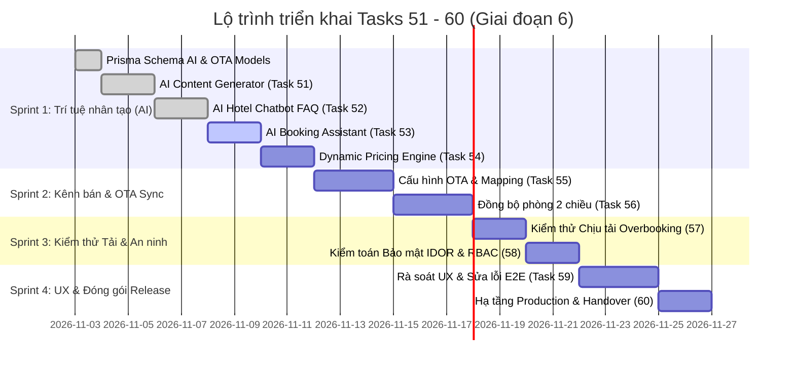

# Kế hoạch triển khai: Tích hợp AI, Kết nối OTA & Kiểm thử Xuất xưởng (Task 51 - 60)

Tài liệu kế hoạch kỹ thuật chi tiết nhằm triển khai 10 tính năng then chốt thuộc phân hệ **Trí tuệ nhân tạo (AI)**, **Đồng bộ kênh bán phòng trực tuyến (OTA Channel Manager)**, **Kiểm thử chịu tải chống bán trùng phòng**, **Kiểm thử bảo mật đa cơ sở (Multi-Tenant Security)** và **Đóng gói xuất xưởng hạ tầng Production** cho nền tảng quản trị khách sạn đa cơ sở **Digistay**.

---

## 1. Danh sách tính năng & Yêu cầu

| ID | Tên tính năng | Mô tả yêu cầu nghiệp vụ | Phân loại |
| :--- | :--- | :--- | :--- |
| **51** | **AI Viết nội dung phòng & Bài viết tự động** | Chủ cơ sở chỉ cần nhập vài từ khóa (ví dụ: *phòng 30m2, view hồ bơi, yên tĩnh, bồn tắm nằm*), AI tự sinh đoạn văn mô tả phòng cuốn hút, chuẩn SEO đa ngôn ngữ (Tiếng Việt & Tiếng Anh). | Trí tuệ nhân tạo (AI) |
| **52** | **Trợ lý AI hỏi đáp dịch vụ khách sạn trên web (Chatbot)** | Cài đặt khung chat AI nổi trên website khách sạn: Phản hồi tự động 24/7 về giờ check-in/out, thực đơn ẩm thực, phụ thu, quy định thú cưng và cẩm nang điểm tham quan lân cận. | Trí tuệ nhân tạo (AI) |
| **53** | **AI Hỗ trợ tìm và chọn phòng trực tiếp qua chat** | Khách nhắn trong khung chat: *"Cuối tuần này có phòng cho 2 người lớn không?"* → AI tự động truy vấn kho phòng trống theo thời gian thực và trả về thẻ phòng kèm nút đặt ngay trong hộp thoại. | Trí tuệ nhân tạo (AI) |
| **54** | **AI Gợi ý định giá phòng theo nhu cầu (Dynamic Pricing)** | Phân tích tỷ lệ lấp đầy phòng còn lại, lịch cuối tuần và các ngày nghỉ lễ lớn sắp tới để đưa ra khuyến nghị định giá tối ưu (ví dụ: *"Nên tăng giá 15% vào cuối tuần này do nhu cầu tăng cao"*), cho phép áp dụng với 1 cú click. | Trí tuệ nhân tạo (AI) |
| **55** | **Kết nối API kênh Agoda, Booking.com (Cấu hình tài khoản)** | Giao diện kết nối tài khoản khách sạn trên nền tảng với các sàn OTA (Agoda, Booking.com, Airbnb) thông qua chuẩn Channel Manager; giao diện ghép nối từng hạng phòng (Room Mapping & Rate Plan Mapping). | Kết nối OTA |
| **56** | **Đồng bộ phòng 2 chiều (Web riêng ↔ Các sàn OTA)** | Đồng bộ tồn kho và đơn phòng hai chiều: Khách đặt trên web riêng → tự động trừ tồn kho trên Agoda/Booking. Khi có đơn đặt từ sàn OTA → tự động cập nhật và đóng phòng trên web riêng. | Kết nối OTA |
| **57** | **Kiểm thử chịu tải, kiểm tra chống bán trùng phòng** | Kịch bản giả lập 100 người dùng bấm đặt 1 phòng cuối cùng vào đúng 1 giây; kiểm chứng cơ chế khóa bi quan (Row Locking / Pessimistic Lock) và Transaction đảm bảo tuyệt đối không bị bán trùng (Zero Overbooking). | Kiểm thử & QA |
| **58** | **Kiểm thử bảo mật & Phân quyền dữ liệu giữa các Workspace** | Kiểm toán an ninh toàn diện: Đảm bảo tuyệt đối tài khoản của khách sạn này không thể truy cập, xem trộm hoặc thao tác dữ liệu doanh thu, phòng, lịch sử khách hàng của khách sạn khác (Chống lỗ hổng IDOR & Tenant Leaks). | Kiểm thử & QA |
| **59** | **Rà soát trải nghiệm người dùng & Sửa lỗi toàn diện** | Kiểm tra toàn bộ hành trình trải nghiệm người dùng từ tạo tài khoản → cấu hình web → trỏ tên miền → đặt phòng → thanh toán VietQR tự động → nhận hóa đơn. Tinh chỉnh giao diện đa thiết bị, đa ngôn ngữ và Dark Mode. | Đảm bảo chất lượng |
| **60** | **Triển khai hạ tầng chính thức & Đóng gói bàn giao** | Triển khai hệ thống lên hạ tầng đám mây Production, cấu hình tự động sao lưu dữ liệu hằng ngày lên Cloud Storage, thiết lập giám sát lỗi và hoàn tất bộ tài liệu hướng dẫn vận hành (Runbook). | Triển khai & Bàn giao |

---

## 2. Kiến trúc & Thiết kế Cơ sở dữ liệu (Prisma Schema)

Hệ thống Digistay áp dụng kiến trúc multi-tenant nghiêm ngặt (`Workspace` ➔ `Property`), bảo vệ quyền truy cập theo vai trò (`WorkspaceMemberRole`), mã hóa thông tin nhạy cảm và ghi vết đồng bộ chi tiết.

### 2.1. Bổ sung Enums & Models mới trong `prisma/schema.prisma`

```prisma
// ============================================================================
// 1. KẾT NỐI KÊNH BÁN OTA (CHANNEL MANAGER) - Task 55, 56
// ============================================================================
enum OtaChannel {
  AGODA
  BOOKING_COM
  AIRBNB
  TRAVELOKA
  EXPEDIA
}

enum ChannelSyncStatus {
  SUCCESS
  FAILED
  PENDING
  PARTIAL
}

enum ChannelSyncDirection {
  OUTBOUND_AVAILABILITY // Digistay đẩy số phòng còn lại sang sàn OTA
  OUTBOUND_RATE         // Digistay đẩy giá phòng sang sàn OTA
  INBOUND_BOOKING       // Sàn OTA đẩy đơn đặt phòng mới về Digistay
  INBOUND_CANCELLATION  // Sàn OTA đẩy thông tin hủy phòng về Digistay
}

model ChannelAccount {
  id               String       @id @default(cuid())
  propertyId       String
  property         Property     @relation(fields: [propertyId], references: [id], onDelete: Cascade)

  channel          OtaChannel   // AGODA, BOOKING_COM, etc.
  hotelIdentifier  String       // Mã khách sạn trên sàn (Hotel ID / Property ID)
  encryptedConfig  String       // JSON chứa API Key, Secret, Webhook Secret (được mã hóa AES-256)
  
  isActive         Boolean      @default(false)
  lastSyncedAt     DateTime?    // Lần đồng bộ thành công gần nhất
  lastError        String?      // Thông điệp lỗi gần nhất (nếu có)

  mappings         ChannelRoomMapping[]
  syncLogs         ChannelSyncLog[]

  createdAt        DateTime     @default(now())
  updatedAt        DateTime     @updatedAt

  @@unique([propertyId, channel])
  @@index([propertyId, isActive])
  @@map("channel_accounts")
}

model ChannelRoomMapping {
  id                 String          @id @default(cuid())
  channelAccountId   String
  channelAccount     ChannelAccount  @relation(fields: [channelAccountId], references: [id], onDelete: Cascade)

  roomTypeId         String
  roomType           RoomType        @relation(fields: [roomTypeId], references: [id], onDelete: Cascade)

  channelRoomId      String          // Room Type ID trên hệ thống sàn OTA
  channelRoomName    String?         // Tên phòng trên sàn để đối soát
  channelRatePlanId  String?         // Mã gói giá trên sàn (vd: Non-Refundable, Standard)
  
  rateMultiplier     Float           @default(1.0) // Hệ số điều chỉnh giá (vd: 1.15 để bán cao hơn 15% bù phí hoa hồng OTA)
  isSyncEnabled      Boolean         @default(true)

  createdAt          DateTime        @default(now())
  updatedAt          DateTime        @updatedAt

  @@unique([channelAccountId, roomTypeId])
  @@index([channelAccountId, isSyncEnabled])
  @@map("channel_room_mappings")
}

model ChannelSyncLog {
  id                 String               @id @default(cuid())
  channelAccountId   String
  channelAccount     ChannelAccount       @relation(fields: [channelAccountId], references: [id], onDelete: Cascade)

  direction          ChannelSyncDirection // OUTBOUND hoặc INBOUND
  status             ChannelSyncStatus    @default(PENDING)
  actionType         String               // INVENTORY_UPDATE, BOOKING_IMPORT, CANCEL_IMPORT
  payloadSummary     String?              // Tóm tắt nội dung gửi/nhận
  payloadDetail      Json?                // Chi tiết gói tin XML/JSON
  errorMessage       String?              // Lỗi trả về từ OTA
  retryCount         Int                  @default(0)

  createdAt          DateTime             @default(now())

  @@index([channelAccountId, createdAt])
  @@index([status, direction])
  @@map("channel_sync_logs")
}

// ============================================================================
// 2. AI CONFIGURATION & CHATBOT - Task 51, 52, 53
// ============================================================================
enum ChatbotRole {
  USER
  ASSISTANT
  SYSTEM
}

model ChatbotConfig {
  id                 String       @id @default(cuid())
  propertyId         String       @unique
  property           Property     @relation(fields: [propertyId], references: [id], onDelete: Cascade)

  isEnabled          Boolean      @default(false)
  botName            String       @default("Lễ tân ảo Digistay")
  welcomeMessageVi   String       @default("Xin chào! Tôi có thể giúp gì cho kỳ nghỉ của bạn tại khách sạn?")
  welcomeMessageEn   String       @default("Hello! How can I assist you with your stay today?")
  customInstructions String?      // Hướng dẫn nghiệp vụ riêng (vd: quy định check-in sớm, món đặc sản nên thử)
  suggestedQuestions String[]     @default(["Giờ check-in và check-out?", "Khách sạn có bãi đỗ xe không?", "Tìm phòng cho cuối tuần này"])

  sessions           ChatbotSession[]

  createdAt          DateTime     @default(now())
  updatedAt          DateTime     @updatedAt

  @@map("chatbot_configs")
}

model ChatbotSession {
  id                 String          @id @default(cuid())
  propertyId         String
  property           Property        @relation(fields: [propertyId], references: [id], onDelete: Cascade)
  configId           String
  config             ChatbotConfig   @relation(fields: [configId], references: [id], onDelete: Cascade)

  guestIp            String?
  userAgent          String?
  language           String          @default("vi") // vi hoặc en
  
  messages           ChatMessage[]

  createdAt          DateTime        @default(now())
  updatedAt          DateTime        @updatedAt

  @@index([propertyId, createdAt])
  @@map("chatbot_sessions")
}

model ChatMessage {
  id                 String          @id @default(cuid())
  sessionId          String
  session            ChatbotSession  @relation(fields: [sessionId], references: [id], onDelete: Cascade)

  role               ChatbotRole     // USER hoặc ASSISTANT
  content            String          // Nội dung tin nhắn
  toolCallPayload    Json?           // Lưu thông tin gợi ý phòng nếu có (Room suggestion metadata)

  createdAt          DateTime        @default(now())

  @@index([sessionId, createdAt])
  @@map("chat_messages")
}

// ============================================================================
// 3. AI DYNAMIC PRICING SUGGESTIONS - Task 54
// ============================================================================
enum DynamicPricingStatus {
  PENDING   // Đang chờ chủ cơ sở duyệt
  APPLIED   // Đã bấm áp dụng
  DISMISSED // Đã từ chối/bỏ qua
  EXPIRED   // Quá hạn hiệu lực
}

model DynamicPricingSuggestion {
  id                 String               @id @default(cuid())
  propertyId         String
  property           Property             @relation(fields: [propertyId], references: [id], onDelete: Cascade)
  roomTypeId         String
  roomType           RoomType             @relation(fields: [roomTypeId], references: [id], onDelete: Cascade)

  targetDate         DateTime             // Ngày đề xuất áp dụng điều chỉnh giá
  currentPrice       Float                // Giá niêm yết hiện tại
  suggestedPrice     Float                // Giá AI khuyến nghị
  percentageChange   Float                // % thay đổi (+15%, -10%, ...)
  reasoningVi        String               // Giải thích bằng tiếng Việt (vd: "Tỷ lệ lấp đầy đạt 85%, sắp đến Tết Dương Lịch")
  reasoningEn        String?              // Giải thích bằng tiếng Anh
  
  status             DynamicPricingStatus @default(PENDING)
  appliedAt          DateTime?

  createdAt          DateTime             @default(now())
  updatedAt          DateTime             @updatedAt

  @@unique([propertyId, roomTypeId, targetDate])
  @@index([propertyId, status, targetDate])
  @@map("dynamic_pricing_suggestions")
}
```

### 2.2. Mở rộng Model hiện có (`Booking` & `Property`)

1. **`Booking`**:
   - Thêm `source String @default("DIRECT_WEB")`: Đánh dấu nguồn gốc đơn (`DIRECT_WEB`, `AGODA`, `BOOKING_COM`, `AIRBNB`, `FRONTDESK`).
   - Thêm `channelBookingId String?`: Mã định danh đơn hàng trên sàn OTA để tránh tạo trùng khi nhận webhook.
   - Thêm `channelMetadata Json?`: Lưu thông tin chi tiết của đơn hàng từ OTA (phí hoa hồng sàn, phương thức thanh toán OTA, thông tin thẻ ảo nếu có).
   - Thêm Index: `@@index([propertyId, channelBookingId])`.
2. **`Property`**:
   - Thêm quan hệ `channelAccounts ChannelAccount[]`.
   - Thêm quan hệ `chatbotConfig ChatbotConfig?`.
   - Thêm quan hệ `dynamicPricingSuggestions DynamicPricingSuggestion[]`.

---

## 3. Kiến trúc Kỹ thuật & Luồng xử lý dữ liệu

```mermaid
flowchart TD
    subgraph AI_Capabilities["Module AI Thông Minh (Task 51, 52, 53, 54)"]
        A["Chủ cơ sở nhập từ khóa"] -->|Gemini Flash Engine| B["Mô tả phòng & Bài viết SEO"]
        C["Khách hỏi trên Web"] -->|Grounded RAG Bot| D["Chatbot giải đáp 24/7"]
        D -->|Tool Calling| E["Tìm phòng & Trả link đặt ngay"]
        F["Phân tích lấp đầy & Ngày lễ"] -->|Thuật toán Dynamic Pricing| G["Gợi ý tăng/giảm giá 1-click"]
    end

    subgraph OTA_Integration["Kênh Bán & Phân Phối OTA (Task 55, 56)"]
        H["Đơn đặt từ Web riêng"] -->|Outbound Push| I["Channel Manager Sync"]
        I -->|Cập nhật tồn kho| J["Agoda / Booking.com API"]
        K["Đơn mới từ Sàn OTA"] -->|Inbound Webhook| L["Idempotent Booking Creator"]
        L -->|Khóa dòng dữ liệu| M["Đóng phòng trên Web riêng"]
    end

    subgraph QA_Security["Kiểm thử Chịu tải & An ninh (Task 57, 58, 59, 60)"]
        N["100 người mua 1 phòng / 1s"] -->|Kiểm thử chịu tải| O["Không bán trùng (Pessimistic Lock)"]
        P["User A gọi API Hotel B"] -->|Kiểm thử bảo mật| Q["Chặn 403 Forbidden (RBAC Isolated)"]
        R["Rà soát toàn bộ luồng User"] -->|Sửa lỗi E2E| S["Production Cloud Ready"]
    end
```



---

## 4. Thiết kế Chi tiết Kỹ thuật theo từng Task

### Task 51: AI Viết nội dung phòng & Bài viết tự động
* **Mục tiêu**: Hỗ trợ chủ cơ sở tạo mô tả hạng phòng và nội dung bài viết tiếp thị chất lượng cao, chuẩn SEO, hỗ trợ song ngữ (Tiếng Việt và Tiếng Anh) chỉ từ các từ khóa phác thảo.
* **Giao diện Dashboard**:
  - Tại trang chỉnh sửa Hạng phòng (`/workspace/[slug]/properties/[id]/rooms`) & trang Soạn thảo Blog (`/blog`):
  - Nút bấm biểu tượng AI: *"Viết tự động bằng AI"*.
  - Modal cấu hình nhanh:
    - *Từ khóa nổi bật*: Ví dụ "35m2, bồn tắm kính, view đồi thông, phù hợp cặp đôi, phong cách Indochine".
    - *Tone giọng*: Sang trọng / Ấm cúng / Trẻ trung năng động.
    - *Ngôn ngữ xuất bản*: Tiếng Việt, Tiếng Anh, hoặc Song ngữ cả hai.
* **Backend & Tích hợp AI**:
  - Endpoint: `POST /api/properties/[id]/ai/generate-content`.
  - Tích hợp Google Gemini Flash API (`gemini-2.5-flash`) với cơ chế fallback dự phòng.
  - System Prompt được tối ưu chuyên biệt cho ngành khách sạn: định dạng đầu ra chuẩn JSON gồm `title`, `shortDescription`, `fullDescription` (định dạng Markdown), `metaTitle`, `metaDescription` (chuẩn độ dài SEO 60/160 ký tự).
  - Tự động điền kết quả vào form để người dùng kiểm tra và chỉnh sửa trước khi lưu.

---

### Task 52: Trợ lý AI hỏi đáp dịch vụ khách sạn trên web (Chatbot)
* **Mục tiêu**: Trợ lý ảo phục vụ 24/7 trên website công khai của từng khách sạn, giải đáp tức thì các câu hỏi thường gặp mà không cần lễ tân trực máy.
* **Giao diện Website Khách sạn**:
  - Khung chat nổi (Floating Chat Bubble) ở góc dưới cùng bên phải website công khai.
  - Hiển thị lời chào cá nhân hóa theo từng khách sạn (`welcomeMessageVi` / `welcomeMessageEn`), danh sách các câu hỏi gợi ý nhanh.
* **Cơ chế Tri thức Định vị (Grounding & Context Injection)**:
  - Khi khởi tạo session hoặc gọi API chat `POST /api/public/chatbot/message`:
  - Hệ thống tự động truy xuất dữ liệu ngữ cảnh thực tế của cơ sở thông qua `loadPropertyKnowledgeBase(propertyId)`:
    - Giờ nhận/trả phòng, chính sách check-in sớm / check-out muộn.
    - Danh sách tiện ích nổi bật & dịch vụ bổ sung (spa, thuê xe, giặt là, bữa sáng).
    - Quy định về trẻ em, thú cưng, hút thuốc.
    - Cẩm nang địa phương: danh sách các quán ăn, điểm du lịch lân cận đã khai báo trong cơ sở dữ liệu.
  - Prompt ràng buộc nghiêm ngặt: AI chỉ trả lời dựa trên thông tin thực tế được cung cấp; nếu thông tin không có trong tài liệu, AI sẽ lịch sự hướng dẫn khách liên hệ hotline của lễ tân thay vì bịa đặt thông tin (Anti-hallucination guardrail).

---

### Task 53: AI Hỗ trợ tìm và chọn phòng trực tiếp qua chat
* **Mục tiêu**: Biến chatbot từ công cụ hỏi đáp thụ động thành nhân viên tư vấn bán phòng chủ động (Conversational Booking Assistant).
* **Kỹ thuật Tool Calling (Function Calling)**:
  - Định nghĩa công cụ `checkRoomAvailability`:
    ```typescript
    {
      name: "checkRoomAvailability",
      description: "Tra cứu danh sách phòng còn trống tại khách sạn theo ngày nhận, ngày trả và số lượng khách",
      parameters: {
        checkInDate: "string (YYYY-MM-DD)",
        checkOutDate: "string (YYYY-MM-DD)",
        guests: "number"
      }
    }
    ```
  - Khi khách hỏi: *"Cuối tuần này (thứ 7 đến chủ nhật) có phòng đôi nào còn trống không bạn?"*, AI tự trích xuất ngày thực tế và gọi hàm nội bộ `findAvailableRooms(propertyId, checkIn, checkOut, guests)`.
* **Hiển thị trực quan trong khung chat (Rich UI Message)**:
  - Phản hồi bằng tin nhắn văn bản thân thiện kèm thẻ Card phòng trực quan:
    - Ảnh đại diện phòng, tên hạng phòng, sức chứa, giá niêm yết/đêm.
    - Nút bấm nổi bật: *"Đặt phòng này ngay"*.
    - Khi bấm, tự động điều hướng sang trang thanh toán (`/checkout`) với ngày nhận/trả và hạng phòng đã được điền sẵn chính xác.

---

### Task 54: AI Gợi ý định giá phòng theo nhu cầu (Dynamic Pricing)
* **Mục tiêu**: Tối đa hóa doanh thu (RevPAR) bằng cách gợi ý điều chỉnh giá linh hoạt theo biến động cung cầu thực tế.
* **Thuật toán & Quy tắc Định giá Thông minh**:
  - Tần suất phân tích: Định kỳ hằng ngày (Internal Cron Job) quét dữ liệu 30 ngày tiếp theo.
  - Dữ liệu đầu vào:
    1. *Tỷ lệ lấp đầy (Occupancy Rate)*: Số phòng đã được đặt / Tổng số phòng khả dụng theo từng ngày.
    2. *Thời gian tới ngày ở (Lead Time)*: Khoảng cách từ hôm nay tới ngày nhận phòng.
    3. *Lịch lễ Tết & Cuối tuần*: Tích hợp danh mục ngày lễ quốc gia Việt Nam (Tết Nguyên Đán, 30/4 - 1/5, 2/9, Giỗ tổ Hùng Vương, Giáng sinh, Tết Dương lịch) và các ngày Thứ 6, Thứ 7.
  - Quy tắc đề xuất:
    - Nếu Tỷ lệ lấp đầy > 80% hoặc ngày Lễ/Cuối tuần ➔ Đề xuất tăng giá +10% đến +25%.
    - Nếu Tỷ lệ lấp đầy < 30% và thời gian tới ngày ở < 3 ngày ➔ Đề xuất giảm giá kích cầu -10% đến -15%.
* **Giao diện Dashboard Quản trị**:
  - Tab *"Định giá thông minh"* tại mục Quản lý Giá phòng (`/workspace/[slug]/properties/[id]/pricing/ai-suggestions`).
  - Danh sách khuyến nghị: Ngày, Hạng phòng, Giá hiện tại ➔ Giá đề xuất, Lý do trực quan (kèm biểu đồ lấp đầy).
  - Nút bấm: *"Áp dụng ngay"* (Cập nhật 1-click vào `RoomTypePricing` và lưu trạng thái `APPLIED`).

---

### Task 55: Kết nối API kênh Agoda, Booking.com (Cấu hình tài khoản)
* **Mục tiêu**: Xây dựng trung tâm kết nối kênh phân phối trực tuyến (Channel Manager Integration Hub), hỗ trợ cấu hình an toàn các tài khoản OTA.
* **Giao diện Dashboard (`/workspace/[slug]/properties/[id]/channels`)**:
  - Danh sách kênh OTA phổ biến: Agoda, Booking.com, Airbnb, Traveloka, Expedia.
  - Nút kích hoạt kênh & Form nhập thông tin kết nối:
    - Mã khách sạn trên sàn (Hotel ID / Property ID).
    - API Key, Secret Token hoặc Thông tin xác thực đối tác OTA.
    - Webhook URL bí mật riêng cho từng cơ sở để nhận thông báo đơn mới từ OTA.
* **Bảo mật & Mã hóa Thông tin**:
  - Áp dụng thuật toán mã hóa đối xứng AES-256-GCM (`src/lib/crypto/secret-box.ts`) trước khi lưu `encryptedConfig` vào DB.
  - Ngăn ngừa tuyệt đối việc lộ khóa API trong mã nguồn hoặc log hệ thống.
* **Giao diện Khai báo Ánh xạ Phòng (Room & Rate Mapping)**:
  - Bảng ghép cặp trực quan:
    - Cột 1: Hạng phòng trên Digistay (ví dụ: *Deluxe Hướng Biển*).
    - Cột 2: Hạng phòng tương ứng trên sàn OTA (nhập hoặc chọn `channelRoomId`).
    - Cột 3: Gói giá (Rate Plan ID).
    - Cột 4: Hệ số chênh lệch giá (Markup / Markdown, ví dụ: 1.15 để giá trên OTA cao hơn 15% bù phí hoa hồng).

---

### Task 56: Đồng bộ phòng 2 chiều (Web riêng ↔ Các sàn OTA)
* **Mục tiêu**: Đảm bảo số lượng phòng khả dụng luôn nhất quán theo thời gian thực trên cả website riêng và các sàn OTA đối tác.
* **Chiều 1: Outbound Sync (Website riêng ➔ Các sàn OTA)**:
  - *Sự kiện kích hoạt*: Khi phát sinh đơn đặt phòng mới, hủy đơn, hoặc lễ tân đóng phòng trên Digistay.
  - Hệ thống đưa tác vụ vào hàng đợi đồng bộ (`ChannelSyncQueue`).
  - Gọi API tương ứng của sàn OTA (Agoda Supply API / Booking.com Connectivity API) cập nhật lại số lượng phòng trống (`allotment`) cho khoảng ngày tương ứng.
  - Ghi nhận trạng thái vào `ChannelSyncLog`.
* **Chiều 2: Inbound Sync (Các sàn OTA ➔ Website riêng)**:
  - Endpoint Webhook: `POST /api/webhooks/channels/[channel]`.
  - Cơ chế bảo mật Webhook: Xác thực chữ ký HMAC Signature từ sàn OTA.
  - Xử lý đơn phòng đến:
    - Phân tích payload (XML / JSON) từ sàn OTA.
    - Tìm `RoomType` tương ứng thông qua bảng `ChannelRoomMapping`.
    - Tạo bản ghi `Booking` trong Digistay với `source = "AGODA"` hoặc `"BOOKING_COM"` và lưu `channelBookingId`.
    - Trừ trực tiếp số lượng phòng khả dụng trong kho phòng của Digistay.
  - Cơ chế Chống lặp (Idempotency): Kiểm tra `channelBookingId`; nếu đơn đã tồn tại trong DB thì bỏ qua và trả mã `200 OK` ngay lập tức.

---

### Task 57: Kiểm thử chịu tải, kiểm tra chống bán trùng phòng
* **Mục tiêu**: Đảm bảo hệ thống đạt tính toàn vẹn tuyệt đối (ACID Transaction), ngăn chặn hiện tượng Overbooking khi có lượng truy cập đột biến.
* **Kịch bản Thử nghiệm Khắc nghiệt**:
  - Thiết lập trạng thái phòng: Cơ sở chỉ còn đúng **01 phòng trống duy nhất** trong khoảng thời gian từ ngày D đến ngày D+2.
  - Giả lập tải: Tạo kịch bản kiểm thử tải tự động sử dụng 100 luồng đồng thời (100 Concurrent HTTP Requests) cùng gửi yêu cầu thanh toán & giữ phòng trong phạm vi 1.000 miligiây (1 giây).
* **Kiểm chứng Kỹ thuật Backend**:
  - Cơ chế Khóa dòng (Row Locking): Áp dụng Prisma Interactive Transaction kết hợp cơ chế kiểm tra `lockBooking` và câu lệnh `SELECT ... FOR UPDATE` trên bảng trạng thái phòng.
  - Tiêu chuẩn nghiệm thu thành công:
    - Đúng **01 yêu cầu duy nhất** được xử lý thành công (`201 CREATED`) và giữ phòng an toàn.
    - **99 yêu cầu còn lại** nhận phản hồi lỗi có kiểm soát (`409 CONFLICT`) với thông điệp rõ ràng: *"Phòng vừa có khách đặt trước, vui lòng chọn phòng khác"*.
    - Không có bất kỳ ngoại lệ Database Deadlock hoặc rò rỉ dữ liệu nào xảy ra.

---

### Task 58: Kiểm thử bảo mật & Phân quyền dữ liệu giữa các Workspace
* **Mục tiêu**: Đảm bảo phân lập dữ liệu đa khách hàng (Multi-Tenant Data Isolation) tuyệt đối an toàn; người dùng ở cơ sở A không thể truy cập hoặc can thiệp dữ liệu cơ sở B.
* **Ma trận Phân quyền & Kiểm tra Lỗ hổng IDOR (Insecure Direct Object References)**:
  - Kiểm thử chéo quyền giữa 4 vai trò: `OWNER`, `ADMIN`, `MEMBER`, `FRONTDESK`.
  - Tạo các bài test tự động cố ý giả lập tấn công IDOR:
    - Người dùng thuộc Workspace X gửi Request đọc doanh thu, danh sách khách hàng, thông tin thẻ/CCCD của Workspace Y.
    - Người dùng cố ý thay đổi `propertyId` trong URL hoặc Request Body để chỉnh sửa giá phòng hoặc đơn đặt của khách sạn khác.
* **Cơ chế Phòng thủ Cốt lõi**:
  - Bắt buộc mọi truy vấn đọc và ghi dữ liệu trong `src/lib/` đều phải thông qua hàm xác thực phân quyền `requirePropertyAccess(userId, propertyId, requiredRole)`.
  - Toàn bộ câu lệnh Prisma `where` bắt buộc chứa bộ lọc ràng buộc `propertyId` và `workspaceId`.
  - Kết quả kiểm thử: Toàn bộ các nỗ lực truy cập trái phép đều phải bị chặn đứng với mã lỗi `403 FORBIDDEN` và được ghi nhật ký cảnh báo an ninh (`AuditSecurityLog`).

---

### Task 59: Rà soát trải nghiệm người dùng & Sửa lỗi toàn diện
* **Mục tiêu**: Tiến hành nghiệm thu toàn diện (End-to-End Walkthrough) từ góc nhìn của Chủ khách sạn và Khách lưu trú, xử lý triệt để các góc cạnh còn vướng mắc.
* **Phạm vi Rà soát Toàn bộ Chu trình Vận hành**:
  1. *Luồng Chủ cơ sở*: Đăng ký tài khoản mới ➔ Tạo Workspace ➔ Thêm Hạng phòng & Giá ➔ Tùy biến màu sắc website ➔ Cấu hình tên miền riêng / Subdomain.
  2. *Luồng Khách lưu trú*: Truy cập website khách sạn ➔ Hỏi đáp với AI Chatbot ➔ Chọn ngày & Hạng phòng ➔ Chọn dịch vụ gia tăng ➔ Nhập mã giảm giá ➔ Quét mã VietQR thanh toán ➔ Nhận email xác nhận tự động tức thì.
  3. *Luồng Lễ tân*: Xem sơ đồ phòng (Room Rack / Timeline) ➔ Tiếp nhận khách Check-in ➔ Ghi nhận phụ thu / Folio dịch vụ tại quầy ➔ Check-out & Tự động gửi email xin đánh giá.
* **Tiêu chuẩn Hoàn thiện Giao diện & Trải nghiệm**:
  - Hỗ trợ đầy đủ chế độ Sáng / Tối (Dark Mode) đồng bộ trên 100% các trang.
  - Chuẩn hóa ngôn ngữ song ngữ Tiếng Việt & Tiếng Anh (không còn sót văn bản cứng hardcoded).
  - Tối ưu hiển thị Responsive mượt mà trên Mobile (iOS Safari, Android Chrome), Tablet và Desktop.

---

### Task 60: Triển khai hạ tầng chính thức & Đóng gói bàn giao
* **Mục tiêu**: Hoàn tất môi trường Production đám mây sẵn sàng tiếp nhận người dùng thật, thiết lập sao lưu tự động và bàn giao tài liệu kỹ thuật hoàn chỉnh.
* **Kiến trúc Hạ tầng Đám mây Production**:
  - Frontend & API Layer: Vercel Enterprise / Docker Cluster với Edge CDN tăng tốc độ tải trang toàn cầu.
  - Database Layer: PostgreSQL Managed Cluster với High Availability (HA) và Connection Pooling (PgBouncer).
  - File Storage: Cloudflare R2 / AWS S3 hỗ trợ Custom CDN Domain cho toàn bộ ảnh phòng và bài viết.
* **Hệ thống Sao lưu & Giám sát Tự động**:
  - Lịch trình tự động sao lưu Database mỗi ngày (Automated Daily Backup) lúc 02:00 AM (giờ Việt Nam), nén và mã hóa tải lên S3 Bucket an toàn.
  - Giám sát sức khỏe hệ thống: Endpoint `/api/health` kiểm tra kết nối DB, Redis, và Email Gateway.
  - Tích hợp công cụ theo dõi lỗi ứng dụng theo thời gian thực (Sentry Error Tracking).
* **Đóng gói Hồ sơ & Tài liệu Bàn giao**:
  - Cập nhật tài liệu vận hành chi tiết: [`docs/RUNBOOK.md`](file:///d:/workInProcess/Digistay/docs/RUNBOOK.md).
  - Hướng dẫn quy trình xử lý sự cố & khôi phục thảm họa: [`docs/DEPLOY-RECOVERY.md`](file:///d:/workInProcess/Digistay/docs/DEPLOY-RECOVERY.md).
  - Sổ tay hướng dẫn sử dụng nhanh dành cho Chủ khách sạn và Nhân viên Lễ tân.

---

## 5. Lộ trình Triển khai & Phân kỳ Sprint



---

## 6. Tiêu chuẩn Kiểm thử & Nghiệm thu (Testing & QA Standards)

Mỗi tính năng trong Giai đoạn 6 bắt buộc phải vượt qua các bài kiểm thử tự động nghiêm ngặt trước khi hợp nhất mã nguồn vào nhánh chính (`main`):

1. **Unit Tests (`*.test.ts`)**:
   - Kiểm tra bộ phân tích cú pháp (Prompt Parser) và xử lý lỗi của Gemini AI client.
   - Kiểm tra thuật toán gợi ý Dynamic Pricing (tỷ lệ lấp đầy, ngày lễ, biên độ tăng/giảm giá).
   - Kiểm tra mã hóa và giải mã thông tin cấu hình kênh OTA (`AES-256-GCM`).
2. **Integration Tests (`*.int.test.ts`)**:
   - Kiểm thử Idempotency của Webhook OTA: Gửi 2 lần cùng một payload đơn hàng OTA ➔ Đảm bảo chỉ tạo đúng 1 bản ghi `Booking`.
   - Kiểm thử logic đồng bộ ngược: Khi booking trên web hủy ➔ Đẩy cập nhật số phòng trống tăng lên cho OTA.
3. **Stress & Concurrency Tests (Kiểm thử tải chống Overbooking - Task 57)**:
   - Kịch bản mô phỏng 100 luồng đồng thời gọi API tạo booking trên 1 phòng duy nhất.
   - Kết quả bắt buộc: 1 giao dịch thành công duy nhất, 99 giao dịch còn lại nhận mã lỗi `409 Conflict`.
4. **Security & Penetration Tests (Kiểm thử bảo mật Multi-Tenant - Task 58)**:
   - Bộ test tự động quét qua 100% các API route: Truy cập tài nguyên của Property khác bằng Token của User không có quyền ➔ Bắt buộc nhận mã lỗi `403 Forbidden`.
5. **End-to-End Tests (Playwright / Vitest Integration)**:
   - Kịch bản kiểm thử tự động toàn diện: Khách chat với AI ➔ Nhận gợi ý phòng ➔ Mở checkout ➔ Thanh toán thành công ➔ Tồn kho giảm trên hệ thống.
6. **Code Quality & CI Checklist**:
   - Không có bất kỳ lỗi cú pháp hoặc cảnh báo kiểu dữ liệu (`npm run typecheck` đạt 0 lỗi).
   - Đạt chuẩn kiểm tra mã nguồn (`npm run lint` đạt 0 cảnh báo).
   - Toàn bộ bộ test hiện có (117 test files, 940+ tests) tiếp tục vượt qua 100%.

